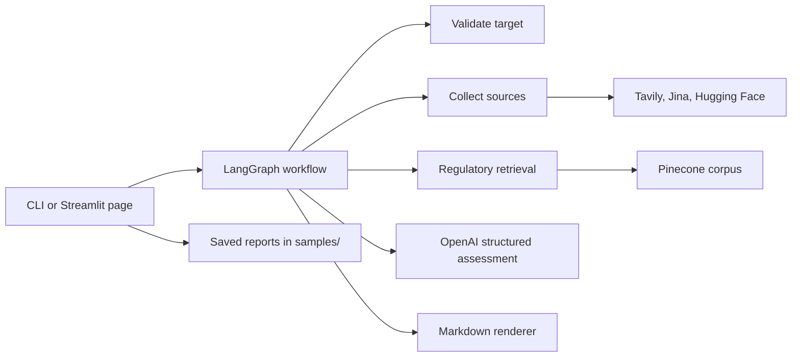

# Model Intake Brief

An offline-first LangGraph CLI with a lightweight Streamlit page for previewing saved reports and running the existing workflow only after an explicit click.

## Scope
- CLI report generation for Hugging Face IDs and hosted provider + model IDs.
- Live source collection with Tavily Search, Jina Reader, Hugging Face Hub, OpenAI assessment, and regulatory retrieval.
- Saved sample reports in `samples/` for offline preview.
- Streamlit interface for opening saved reports and launching the same graph manually.

## Verified locally in this checkout
The interpreter, tests, and saved-report preview were verified here with the existing Miniconda interpreter.

1. Confirm the active interpreter:
   - `C:\Users\serge\miniconda3\python.exe -c "import sys; print(sys.executable)"`
2. Run the offline and mocked verification suite:
   - `PYTHONPATH=src C:\Users\serge\miniconda3\python.exe -m pytest -q`
3. Verify the Streamlit helpers load both saved reports without calling the graph.

## Fresh-clone checks
Repeat these after a clean clone if you need to confirm the environment from scratch.

- Run the editable install command in the setup section if the Miniconda environment does not already have the package installed.
- Re-run the test suite command above.
- Launch the Streamlit page with the commands in the run section below and confirm that opening the page and switching samples does not trigger any live call.

## Run commands
Use the existing Miniconda interpreter and `PYTHONPATH=src`.

### Offline CLI
- Hugging Face checkpoint: `PYTHONPATH=src C:\Users\serge\miniconda3\python.exe -m intake run --model Qwen/Qwen3-8B`
- Hosted checkpoint: `PYTHONPATH=src C:\Users\serge\miniconda3\python.exe -m intake run --provider openai --model gpt-5.2-2025-12-11`
- Invalid input: `PYTHONPATH=src C:\Users\serge\miniconda3\python.exe -m intake run --model invalid`

### Live research and indexing
- Hugging Face live draft: `PYTHONPATH=src C:\Users\serge\miniconda3\python.exe -m intake run --live --model Qwen/Qwen3-8B`
- Hosted live draft: `PYTHONPATH=src C:\Users\serge\miniconda3\python.exe -m intake run --live --provider openai --model gpt-5.2-2025-12-11`
- Regulatory index command: `PYTHONPATH=src C:\Users\serge\miniconda3\python.exe -m intake index-regulatory`

### Streamlit page
- `PYTHONPATH=src C:\Users\serge\miniconda3\python.exe -m streamlit run app.py`

## Environment variables
The live commands read `.env` only when you run a live or indexing command.

- `TAVILY_API_KEY`
- `INTAKE_PROVIDER_DOMAINS`
- `INTAKE_TAVILY_TIMEOUT_SECONDS`
- `INTAKE_JINA_TIMEOUT_SECONDS`
- `INTAKE_HF_TIMEOUT_SECONDS`
- `INTAKE_ASSESSMENT_TIMEOUT_SECONDS`
- `INTAKE_RAG_TIMEOUT_SECONDS`
- `OPENAI_API_KEY`
- `PINECONE_API_KEY`
- `PINECONE_INDEX_NAME`
- `PINECONE_NAMESPACE`
- `PINECONE_API_VERSION`

## Architecture

## Tools
- `Tavily Search` discovers candidate URLs for live research.
- `Jina Reader` extracts text from public pages after HTTPS and host validation.
- `Hugging Face Hub` fetches public metadata for Hugging Face model IDs.
- `OpenAI Responses` performs the structured evidence assessment with a 4,000-output-token cap.
- `Pinecone` stores and retrieves the small regulatory corpus.

## Indexing and retrieval
- Index the regulatory corpus with `PYTHONPATH=src C:\Users\serge\miniconda3\python.exe -m intake index-regulatory`.
- Retrieval happens inside the graph after the checklist is loaded.
- The configured namespace stays separate from other Pinecone data.
- The checked corpus covers the verified AI Act passages plus the verified GPAI Code of Practice transparency measures 1.1 and 1.2.

## File map
- `src/intake/cli.py`: command-line entry point and report output.
- `src/intake/graph.py`: LangGraph state machine and source routing.
- `src/intake/adapters.py`: Tavily, Jina, and Hugging Face adapters.
- `src/intake/assessment.py`: OpenAI assessment, validation, and Markdown rendering.
- `src/intake/regulatory.py`: corpus loading, indexing, and retrieval helpers.
- `app.py`: Streamlit page for previewing saved reports and running the graph.
- `samples/qwen3-8b.md`: saved live Qwen report.
- `samples/gpt-5.2.md`: saved live hosted-model report.
- `tests/`: regression coverage for offline, live-mocked, and UI helpers.

## Saved reports
- [Qwen/Qwen3-8B sample](samples/qwen3-8b.md)
- [GPT-5.2 sample](samples/gpt-5.2.md)

## Current behavior
- Offline mode does not read `.env` and keeps the deterministic fixture draft.
- The Streamlit page loads saved reports without calling the graph until the user clicks `Run graph`.
- Live mode reads `.env` only for the configured API keys, timeout values, provider domain allowlist, embeddings key, assessment timeout, and Pinecone configuration.
- Live research drafts use Tavily Search, Jina Reader, and Hugging Face Hub for Hugging Face IDs, and skip Hugging Face for hosted provider IDs.
- The Day 3 report uses `gpt-5.4-mini` for structured evidence assessment, keeps model-provider attribution separate from the hosting platform, writes the final Markdown to stdout, and renders `## Full report` for a successful live run while preserving partial and offline labels when needed.
- The hosted GPT-5.2 demo target also seeds the provider-published training-content summary at `https://cdn.openai.com/pdf/gpt-5-2-eu-ai-act-public-summary-of-training-content.pdf` as a preferred Jina candidate source, while keeping the official model documentation and redirect allowlist in place.
- The regulatory corpus includes verified AI Act passages and verified GPAI Code transparency measures 1.1 and 1.2, extracted from the readable mirror when the official PDF could not be read directly in this environment.
