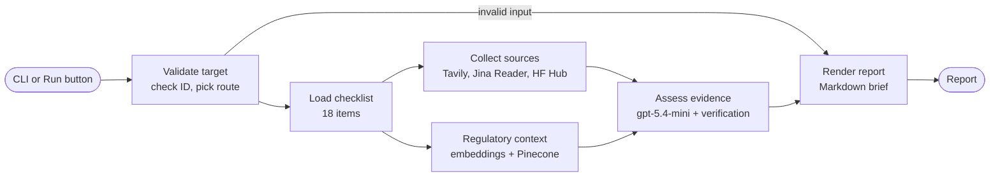

# Model Intake Brief

An autonomous LangGraph agent that reviews the public documentation of an AI model before a company integrates it. You give it a model ID. It finds the provider's documentation, reads it, checks it against a fixed 18-item checklist based on the EU AI Act rules for general-purpose AI models (Article 53, Annexes XI and XII) and the GPAI Code of Practice, and writes a structured Markdown brief: what is documented, what is missing, and what to ask the provider.

**Information, not legal advice.** The brief reports what public sources say. It does not decide compliance.

- **Demo:** presented live on 13 November 2026; the saved reports in `samples/` are the backup
- **Slides:** [presentation/project3_slides.pdf](presentation/project3_slides.pdf)
- **Stack decision:** [stack_decision.md](stack_decision.md)
- **Future GTM sprints:** [gtm_future_sprints.md](gtm_future_sprints.md)
- **Sample reports:** [Qwen/Qwen3-8B](samples/qwen3-8b.md) (open weights, detailed model card) and [GPT-5.2](samples/gpt-5.2.md) (closed, hosted API)

## Problem and user

An AI governance lead, AI PMO or risk reviewer has to approve third-party models before teams build on them. Today that means hours of searching model cards, docs and trust pages, and the result depends on who did the search. The brief gives the reviewer a repeatable first pass: every checklist item gets a status (evidence found, partial, not found or not checked), a verified quote and a link where evidence exists, and a prioritised list of questions for the provider where it does not.

## Setup

Requirements: Python 3.11 or later, and Git.

```bash
git clone https://github.com/s-rostovskyi/model-intake-brief.git
cd model-intake-brief
python -m venv .venv
# Windows PowerShell: .venv\Scripts\Activate.ps1    macOS / Linux: source .venv/bin/activate
python -m pip install -e .
```

`pip install -e .` installs the `intake` package and its dependencies (`langgraph`, `pydantic`, `requests`, `streamlit`) from `pyproject.toml`. The offline preview and the saved reports need nothing else.

For live analysis:

1. Copy `.env.example` to `.env` and fill in your own keys. `.env` is ignored by Git. Never commit it.
2. Create a Pinecone index with dense vectors of dimension `1536` and cosine similarity, and put its name in `PINECONE_INDEX_NAME`.
3. Load the regulatory corpus into it once: `python -m intake index-regulatory`.

| Variable | Used for |
|---|---|
| `TAVILY_API_KEY` | Tavily Search |
| `OPENAI_API_KEY` | Assessment model and embeddings |
| `PINECONE_API_KEY`, `PINECONE_INDEX_NAME`, `PINECONE_NAMESPACE`, `PINECONE_API_VERSION` | Regulatory retrieval |
| `INTAKE_PROVIDER_DOMAINS` | Official domains for hosted models, comma-separated (for OpenAI: `openai.com,platform.openai.com,developers.openai.com,help.openai.com,cdn.openai.com`). Hugging Face targets always use `huggingface.co`. |
| `INTAKE_TAVILY_TIMEOUT_SECONDS`, `INTAKE_JINA_TIMEOUT_SECONDS`, `INTAKE_HF_TIMEOUT_SECONDS`, `INTAKE_ASSESSMENT_TIMEOUT_SECONDS`, `INTAKE_RAG_TIMEOUT_SECONDS` | Optional request timeouts in seconds |

Jina Reader and the Hugging Face Hub are used through their public endpoints and need no key.

## How to run

The trigger is one command or one button. After it, the graph runs to the finished report without human steps.

**Command line** (the entry point is `src/intake/cli.py`, run as `python -m intake`):

```bash
# Offline preview with fixture data, no API calls
python -m intake run --model Qwen/Qwen3-8B

# Live analysis of an open-weights model on Hugging Face
python -m intake run --live --model Qwen/Qwen3-8B

# Live analysis of a hosted model
python -m intake run --live --provider openai --model gpt-5.2-2025-12-11
```

The report is printed to standard output as Markdown. To save it on Windows: `cmd /d /c "python -X utf8 -m intake run --live --model Qwen/Qwen3-8B > qwen.md"`. Exit code `0` means a report without workflow errors, `2` an input or workflow error (a partial report may still be printed).

**Web interface:**

```bash
python -m streamlit run app.py
```

Open `http://localhost:8501`. **Saved reports** shows the two sample reports with no API calls. **Run a new analysis** starts the same graph, draws it live in the **Pipeline view** and shows the report with a dashboard. The [User guide](USER_GUIDE.md) explains every control.

**Tests and checks:**

```bash
python -m pip install pytest
python -m pytest -q                                              # offline and mocked tests, no API calls
python -m intake stability --live --model Qwen/Qwen3-8B -n 5     # same live analysis 5 times, compare statuses
```

## Architecture



1. **Validate target.** Checks the input and picks the route: a Hugging Face `ORG/MODEL` ID or a hosted provider with an exact model ID. Invalid input goes straight to the renderer, which reports the error.
2. **Load checklist.** Reads the 18 items from `model-intake-checklist.md`: 15 core checks and 3 training-resource checks kept as context.
3. **Collect sources** and **Regulatory context** run in parallel. Collection runs two Tavily searches (restricted to the provider's domains) and, for Hugging Face models, the Hub API, then reads the top candidate pages with Jina Reader. Retrieval embeds one query per checklist item and fetches the closest passages from Pinecone.
4. **Assess evidence** starts when both branches are done. The model proposes a status, a source and a short quote for each item, using the regulatory passages for the provisions that item cites to interpret the criterion. Python then verifies every quote against the extracted page text, flags evidence about a different model or variant, and checks that cited links answer.
5. **Render report.** Python assembles the brief, the provider questions and the regulatory context.

LangGraph state carries the target, the checklist, every tool outcome, the regulatory passages and the findings from node to node. Independent calls inside a node also run in parallel (searches, page reads, Pinecone queries, link checks), with results kept in a fixed order so the report does not depend on timing.

## Tools and models

| Tool or model | Role |
|---|---|
| Tavily Search | Finds candidate documentation pages on approved domains |
| Jina Reader | Extracts text from model cards, docs, trust pages and PDFs |
| Hugging Face Hub API | Repository metadata for open-weights models |
| Link check (HTTP) | Confirms that every cited link answers, and that redirects stay on approved domains |
| OpenAI `gpt-5.4-mini` (Responses API, structured output, 4,000 output-token cap) | Proposes a status, source and quote per checklist item |
| OpenAI `text-embedding-3-small` | Embeds the regulatory corpus and the per-item queries |
| Pinecone | Vector store for the regulatory corpus |

## Grounding (RAG)

The regulatory corpus holds 13 verified passages: EU AI Act Article 53 and Annexes XI and XII (Regulation (EU) 2024/1689), and the GPAI Code of Practice Transparency chapter, measures 1.1 and 1.2. The passages tell the assessment what each checklist item means. They can never count as evidence about the model: only provider sources can support a finding, and every quote has to be found in the text of the source it cites.

## The report

Delivered as Markdown: printed by the CLI, and downloadable from the web interface.

1. **Header**: exact model, provider, hosting platform, run date, checklist version, the legal notice and token usage.
2. **Summary**: a one-line headline, counts by status and the major gaps.
3. **Source collection**: every tool call and its outcome, including failures.
4. **Findings**: one block per checklist item with status, quote, source link, model applicability, link check and the gap explanation.
5. **Prioritised provider questions**: one question per open gap.
6. **Methods and limitations**.
7. **Regulatory context**: the retrieved provisions per item.

Statuses: **Evidence found** (meets the criterion and applies to this model), **Partial**, **Not found** (no supporting evidence in this run, which is not proof that it does not exist) and **Not checked** (a tool failed or offline mode).

## File map

| Path | Purpose |
|---|---|
| `src/intake/cli.py`, `src/intake/__main__.py` | Command-line entry point (`python -m intake`) |
| `src/intake/graph.py` | LangGraph state, nodes, edges, parallel branches and pipeline events |
| `src/intake/adapters.py` | Tavily, Jina Reader and Hugging Face Hub adapters |
| `src/intake/assessment.py` | OpenAI assessment, quote verification, link checks, Markdown rendering |
| `src/intake/regulatory.py` | Regulatory corpus, Pinecone indexing and retrieval |
| `src/intake/checklist.py`, `model-intake-checklist.md` | The 18-item checklist and its loader |
| `src/intake/settings.py` | Reads `.env` for live runs |
| `src/intake/fixtures.py` | Fixture data for the offline preview |
| `src/intake/runner.py` | Streams a run as events for the web interface |
| `src/intake/pipeline_view.py`, `assets/pipeline.css` | Live diagram of the graph (Pipeline view) |
| `src/intake/report_review.py`, `src/intake/dashboard.py`, `assets/dashboard.css` | Report parsing and the report overview dashboard |
| `src/intake/stability.py` | Repeated runs and status comparison (`python -m intake stability`) |
| `app.py`, `assets/`, `.streamlit/config.toml` | Streamlit web interface and its theme |
| `samples/` | Two reports generated by the system |
| `tests/` | Offline, mocked-live and interface tests |
| `USER_GUIDE.md` | How to use the interface and the CLI, and how to read the report |
| `stack_decision.md`, `gtm_future_sprints.md` | Stack rationale and future GTM sprints |
| `model-intake-day1.md` | Day 1 plan: user, scope, workflow draft and report template |
| `stability.md` | Result of a 5-run stability check on Qwen/Qwen3-8B |
| `.env.example` | Names of the environment variables, no secrets |

## Known limits

- **Status variance.** The assessment is an LLM call, so the line between *partial* and *not found* can move between runs on the same sources. `python -m intake stability` measures it; `stability.md` shows a 5-run check made before the latest assessment change.
- **One research pass.** The graph searches once per run. A follow-up search loop for items still *not found* is planned, not built.
- **Public sources only.** Gated pages, rate limits and documents published for a different model version can lead to *partial* or *not found*.
