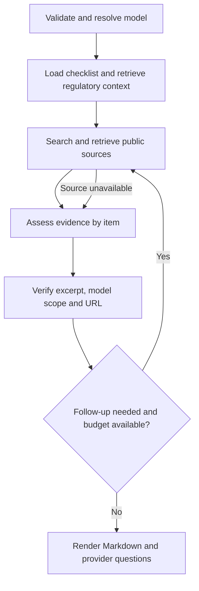

# Model Intake Brief — Day 1 plan

## Industry, report user and scope

EU AI governance. An AI governance or PMO lead uses the brief to review a third-party model before integration. Given a Hugging Face model ID or a provider and exact hosted model ID, the agent produces an English Markdown report. The reviewer should be able to identify public evidence and prioritize provider questions in under ten minutes. This is a target to measure, not a measured result.

The demo targets are Qwen/Qwen3-8B and OpenAI GPT-5.2 (gpt-5.2-2025-12-11). The CLI is the primary entry point. A small Streamlit view will use the same workflow. The research inputs are Tavily Search, Jina Reader and Hugging Face Hub. An independent HTTP check records whether evidence links resolve. The regulatory corpus is indexed in Pinecone and embedded with text-embedding-3-small. GPT-5.4 Mini (gpt-5.4-mini) is the planned research and evidence assessment model.

## Workflow draft

Hugging Face Hub is used for Hub model IDs. A hosted-model run searches the provider's official documentation. The graph records failed source checks and carries usable evidence forward into the report.

## Report template

1. **Header** — exact model, provider, date, checklist version and “Information, not legal advice.”
2. **Summary** — the strongest public evidence, major gaps and counts by status.
3. **Findings** — item, status, excerpt, source and section, model applicability, retrieval date, link check and regulatory reference. For missing evidence, list the relevant sources checked. For failed checks, show the cause.
4. **Provider questions** — prioritized questions for integration, with each question tied to an unresolved finding. Keep regulator-facing context separate.
5. **Method and limits** — sources used, unsuccessful requests and the boundaries of public research.

## Future GTM sprint titles

1. Validate intake time and usefulness with AI governance practitioners.
2. Pilot report handoff into an existing AI inventory.
3. Test demand for a paid model intake review.
